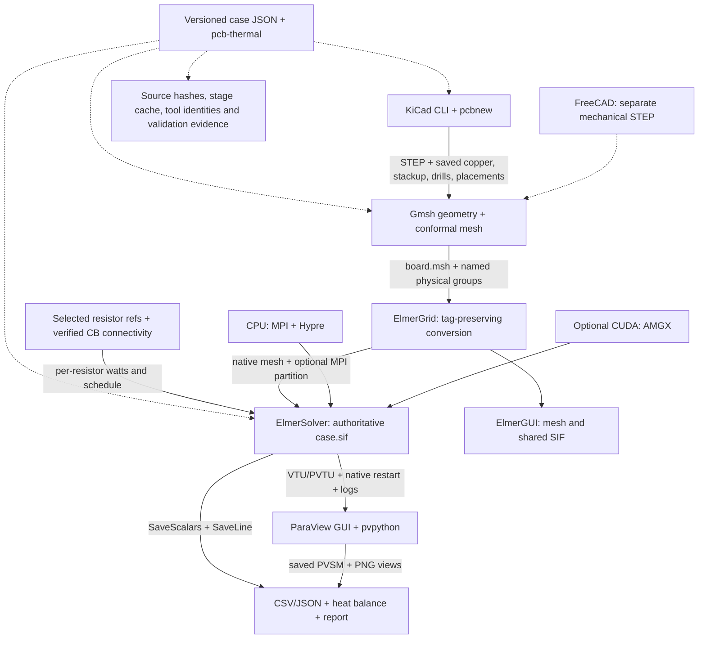

# PCB Thermal Lab

File-based PCB heat-conduction simulation with KiCad, Gmsh, Elmer and ParaView.
The reusable tooling lives here; board-specific cases live with the hardware.
Both scripts and GUI applications inspect the same exported geometry, mesh,
solver input and result files.

**The tooling and reduced CPU steady runs are implemented; full numerical
validation remains open.** The limited BMS detail-region check failed local
hotspot convergence, so its results remain provisional. The BMS simulation
scope is closed at the steady study; further BMS simulations are not planned.
A successful image build is not a validated thermal result.

## Quick start

The supported starting platform is x86-64 Ubuntu 24.04 with Python 3 and
rootless Podman. CPU simulation does not require NVIDIA. Docker-compatible
recipes are provided; select Docker with `PCB_THERMAL_ENGINE=docker`.

```bash
git clone https://github.com/gerhardmalberg88/pcb-thermal-lab.git
cd pcb-thermal-lab
./pcb-thermal bootstrap
python3 -m venv --system-site-packages .venv
. .venv/bin/activate
python -m pip install --no-build-isolation -e .
./pcb-thermal build --profile cpu --jobs 2
./pcb-thermal doctor --backend cpu --full
pcb-thermal run "$PWD/examples/layered-via/case.json" --backend cpu
```

Bootstrap uses sudo for host prerequisites and does not replace the graphics
driver. The editable installation exposes `pcb-thermal` from any working directory; keep
the lab checkout in place. No hardware or EM checkout is required for this example.
The checkout launcher also works without installation. Case files use JSON,
read with Python's standard library.
Sources and build artifacts are pinned in `env/pins.json`; completed builds
record portable container package inventories and image identities under
`env/locks/`. Machine-specific native build records are ignored.
The tools image shares the CPU image layers to save storage. It adds pinned
ParaView 5.13.3 because Ubuntu's older VTK/Expat combination fails to read some
native binary VTU files.
FreeCAD is unpacked from a checksum-verified AppImage; it does not require FUSE.

```bash
./pcb-thermal bootstrap --cuda
./pcb-thermal build --profile cuda --cuda-arch 75 --cuda-version 12.9.1
./pcb-thermal doctor --backend cuda --full
pcb-thermal run "$PWD/examples/layered-via/case.json" --backend cuda --mpi-ranks 1
```

CUDA accelerates Elmer's linear solve through AMGX. Geometry, meshing and FEM
assembly use the CPU. Explicit `cpu` never probes NVIDIA. `auto` reports its
preflight selection; unavailable explicit `cuda` fails. Solver failures stop
the run without changing backend.

## Workflow



Hybrid models retain the whole board as a conductor. Copper, laminate,
plated vias, solder connections and resistor bodies are explicit near the
resistors; the outer region uses spatially varying orthotropic properties
derived from the saved copper and via fractions. Source selection is separate
from domain selection. Cropped models and fully explicit models use the same
configuration interface. See [case configuration](docs/cases.md).

The quick start uses the independent [layered-via fixture](examples/layered-via/README.md).
For a board-specific balancing case, install this CLI once and supply the case's
path from any directory:

```bash
pcb-thermal study /path/to/hardware/sim/thermal/CASE/config.json \
  --section steady --schedules odd even --time-budget-minutes 120
```

This selects only the requested schedules, prioritizes h = 10, 5, 50, 20 W/m²K,
and preserves verified existing automatic results. It runs CPU cases sequentially
with two MPI ranks and one thread per rank. The first case has at most 20 minutes
including preparation; later cases have 12 minutes each. A two-minute shutdown
reserve is included in the overall budget. Optional `--detail-check` allows one
20 mm detailed-region comparison, capped at 20 minutes, only when at least
25 minutes remain after the selected cases.

The output parent contains a checkpointed JSON, CSV, Markdown report and
convection plot. Historical results are accepted only with unchanged source
hashes, matching physical assumptions and converted meshes, successful native
Elmer completion, intact artifacts and <1% heat imbalance. Mesh/domain validation
and hardware correlation remain separate. See [study operation](docs/studies.md)
for status meanings, interruption and deferred study commands.

## Stages, GUI and results

```bash
./pcb-thermal run CASE.json --stage extract --backend cpu
./pcb-thermal run CASE.json --stage mesh --backend cpu
./pcb-thermal run CASE.json --stage convert --backend cpu
./pcb-thermal run CASE.json --stage solve --backend cpu --mpi-ranks 2
./pcb-thermal run CASE.json --stage postprocess --backend cpu
./pcb-thermal sweep CASE.json --parameter cooling.h_w_m2k --values 5 10 20 50
./pcb-thermal gui gmsh --workdir /absolute/results/mesh -- /work/board.msh
./pcb-thermal gui freecad --workdir /absolute/results/extract -- /work/board.step
./pcb-thermal gui elmer --workdir /absolute/results/solve/mesh
./pcb-thermal gui paraview --workdir /absolute/results -- --state=/work/postprocess/view.pvsm
./pcb-thermal gui pcbnew --workdir /absolute/hardware/design -- /work/board.kicad_pcb
```

Stages resolve their prerequisites. Completed stages are reused only after
hash verification; phase and convection studies share geometry where possible.
`--force` replaces owned stage directories. Keep manual GUI work in a separate
copy. `--sif FILE` supplies an explicitly edited solver input for a scripted run.
Pipeline input designs are mounted read-only in containers. A GUI's selected
working directory is writable; use a copy for inspection or manual edits.
Native diagnostic execution also checks source hashes but does not provide
container mount isolation.

In ElmerGUI, use **File → Load Project** and select `/work` when launched
with `--workdir /absolute/results/solve/mesh`. The project is under `solve/mesh/`. Its SIF uses the same physical
model as `solve/case.sif`; GUI **Sif → Generate** replaces hand-edited settings.
ParaView opens native fields or `postprocess/view.pvsm`; after transferring a
run, use ParaView's data-directory relocation or `postprocess/open-view.py`.
X11/XWayland forwarding uses the existing authentication cookie. Scripted
rendering uses Xvfb and software OpenGL.

Every completed run preserves native Elmer meshes, SIF, final restart,
temperature/heat-flux fields, scalar and line data with column descriptions,
and logs. Derived outputs include `report.md`, `summary.json`, `history.csv`,
per-resistor CSV, views and plots. Temperatures of omitted components are
reported only as nearby board temperatures; external sensor and junction
temperatures are not inferred.

## Portability and resources

```bash
./pcb-thermal export /path/to/image-archives --profile all
# On another x86-64 Linux machine:
./pcb-thermal import /path/to/image-archives
```

Exports include archive hashes and image identities. Copy the hardware inputs
and selected result directories separately. Native files remain usable outside
the containers. Updating an archive temporarily needs space for its replacement;
the previous valid archive is retained until the export succeeds. Builds default
to two jobs; CPU solves default to two ranks and
one thread per rank. Use mesh/domain convergence rather than globally refining
every feature. The available disk space is not a substitute for sufficient RAM.
Pipelines in the same checkout run one at a time. The editable
`execution.max_memory_gib` defaults to 8 GiB, with an additional host-memory
pressure guard and 2 GiB disk reserve. Native outputs from interrupted stages
are retained before a rerun. No command automatically deletes unrelated images
or results.

## License and sources

Original software and documentation are [Apache-2.0](LICENSE), matching PCB EM
Lab; see [NOTICE](NOTICE). Hardware designs, BMS cases and local component models
retain their CERN-OHL-P-2.0 license. Installed third-party software retains its
own license.

Thermal equations, solver keywords and output formats follow the
[Elmer manuals](https://www.nic.funet.fi/pub/sci/physics/elmer/doc/).
Balancing control and switch resistance follow the
[TI BQ79616-Q1 datasheet](https://www.ti.com/lit/ds/symlink/bq79616-q1.pdf);
resistor dimensions follow the
[Vishay RCL e3 datasheet](https://www.vishay.com/docs/20046/rcle3.pdf).
